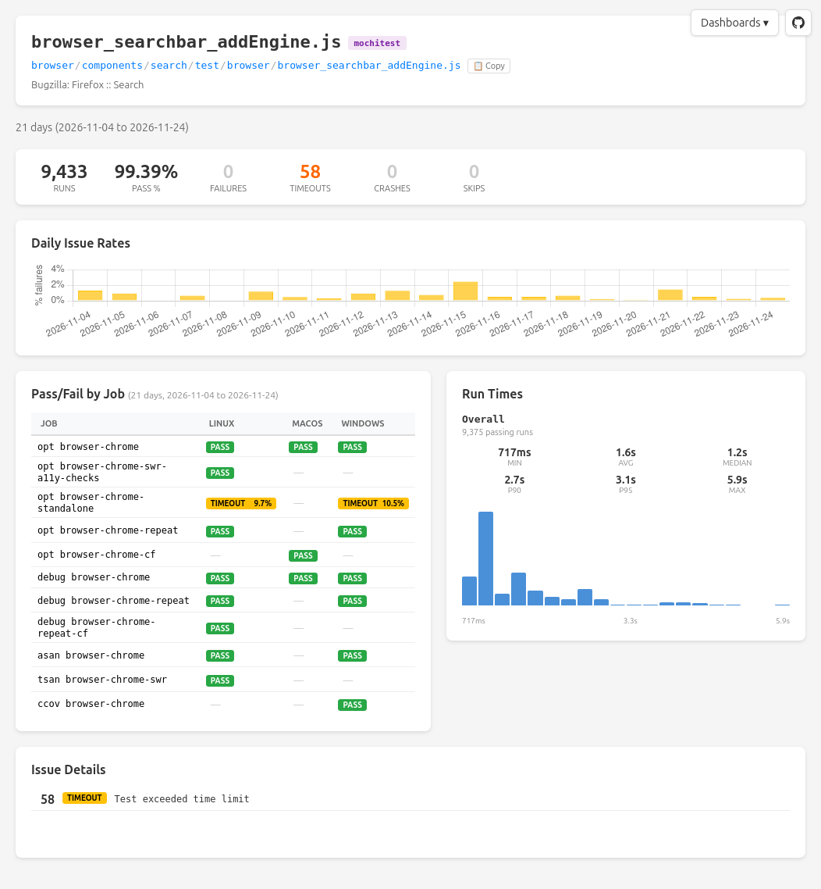
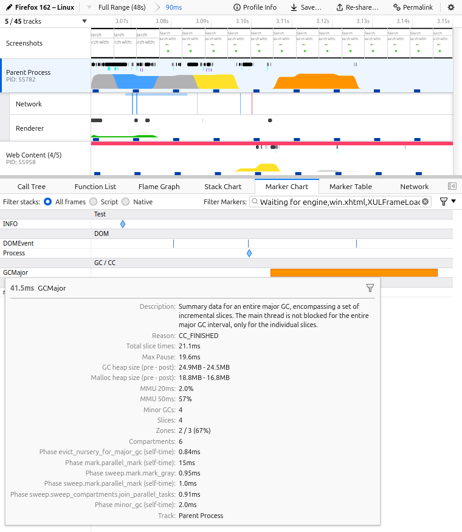

An intermittent timeout, nothing useful in the log, and a test that always passes locally: this used to mean days of try pushes and debug logging. This time, the profile that CI recorded for the failing test showed what was unusual about that run, and that was enough to make the test fail every time on my machine.

## The symptom

[The test's dashboard](https://tests.firefox.dev/test.html?test=browser%2Fcomponents%2Fsearch%2Ftest%2Fbrowser%2Fbrowser_searchbar_addEngine.js) shows that [`browser_searchbar_addEngine.js`](https://searchfox.org/firefox-main/source/browser/components/search/test/browser/browser_searchbar_addEngine.js) timed out about 10% of the time on standalone jobs over the last 3 weeks:



The test opens a page offering search engines, clicks one of the "Add" buttons that the search bar then shows, and waits for the engine to be installed. The standalone jobs restart the browser before each test file, so each test runs in a freshly started browser. The log of a failure says this, and nothing else:

```
INFO - Entering test test_addEngine
INFO - TEST-PASS | browser/components/search/test/browser/browser_searchbar_addEngine.js | test_addEngine - All items are in addEngineList - 3 == 3
INFO - Waiting for engine to be installed.
INFO - TEST-FAIL | browser/components/search/test/browser/browser_searchbar_addEngine.js | test_addEngine - Test timed out
```

The test clicked the button and waited 45 seconds for an engine that never came.

## Debugging, the old way

Locally, the test passed more than 20 times in a row: whatever happens on CI wasn't happening on my machine.

Without a local reproduction, the remaining options were to push to try with more logging, or to land the logging and wait for the next failures. The failure rate here was high enough to make try pushes usable, but each round takes hours, and the logging has to be decided in advance: guess wrong about what to log, and it's another round.

## What installing an OpenSearch engine does

For [security reasons](https://bugzilla.mozilla.org/show_bug.cgi?id=1704114), the XML description of an OpenSearch engine is processed in a hidden browser rather than in the parent process. [`parseInHiddenBrowser`](https://searchfox.org/firefox-main/rev/4f6c8bb9a859667fd209b81d795a962dbf656807/toolkit/components/search/OpenSearchLoader.sys.mjs#105-161) loads `about:blank` in that hidden browser, waits for a progress listener to report that the load finished, and then sends the XML to that page.

## What the profiles show

For the last few months, [mochitests have run with the profiler enabled](https://bugzilla.mozilla.org/show_bug.cgi?id=2050028), so when a test fails, its profile is uploaded as an artifact of the job (the log has a line saying `profile uploaded in profile_browser_searchbar_addEngine.js.json.gz`).

Here is [the profile of one of the failing runs](https://profiler.firefox.com/public/vwxbcnvz4tgqmykdrf7m47kfh0rqyax1xm52x20/marker-chart/?globalTrackOrder=awc0896537421&hiddenGlobalTracks=1w57wb&hiddenLocalTracksByPid=55782-1w57wd~56018-01~55921-01~56035-01~56208-01~56025-01~55958-01~56051-01~55912-01~56077-01&localTrackOrderByPid=55912-10&thread=0&v=17). Right after the test [starts waiting for the engine](https://profiler.firefox.com/public/vwxbcnvz4tgqmykdrf7m47kfh0rqyax1xm52x20/marker-chart/?globalTrackOrder=awc0896537421&hiddenGlobalTracks=1w57wb&hiddenLocalTracksByPid=55782-1w57wd~56018-01~55921-01~56035-01~56208-01~56025-01~55958-01~56051-01~55912-01~56077-01&localTrackOrderByPid=55912-10&marker=50395&range=3060m90&thread=0&v=17&markerSearch=Waiting%20for%20engine,win.xhtml,XULFrameLoaderCreated,Reused%20process,DocumentLoad,AppTestDelegate:load,GCMajor), the markers show the hidden browser being set up: its [invisible window](https://profiler.firefox.com/public/vwxbcnvz4tgqmykdrf7m47kfh0rqyax1xm52x20/marker-chart/?globalTrackOrder=awc0896537421&hiddenGlobalTracks=1w57wb&hiddenLocalTracksByPid=55782-1w57wd~56018-01~55921-01~56035-01~56208-01~56025-01~55958-01~56051-01~55912-01~56077-01&localTrackOrderByPid=55912-10&marker=51079&range=3060m90&thread=0&v=17&markerSearch=Waiting%20for%20engine,win.xhtml,XULFrameLoaderCreated,Reused%20process,DocumentLoad,AppTestDelegate:load,GCMajor), the [`<browser>` element](https://profiler.firefox.com/public/vwxbcnvz4tgqmykdrf7m47kfh0rqyax1xm52x20/marker-chart/?globalTrackOrder=awc0896537421&hiddenGlobalTracks=1w57wb&hiddenLocalTracksByPid=55782-1w57wd~56018-01~55921-01~56035-01~56208-01~56025-01~55958-01~56051-01~55912-01~56077-01&localTrackOrderByPid=55912-10&marker=51339&range=3060m90&thread=0&v=17&markerSearch=Waiting%20for%20engine,win.xhtml,XULFrameLoaderCreated,Reused%20process,DocumentLoad,AppTestDelegate:load,GCMajor) getting a [content process](https://profiler.firefox.com/public/vwxbcnvz4tgqmykdrf7m47kfh0rqyax1xm52x20/marker-chart/?globalTrackOrder=awc0896537421&hiddenGlobalTracks=1w57wb&hiddenLocalTracksByPid=55782-1w57wd~56018-01~55921-01~56035-01~56208-01~56025-01~55958-01~56051-01~55912-01~56077-01&localTrackOrderByPid=55912-10&marker=51348&range=3060m90&thread=0&v=17&markerSearch=Waiting%20for%20engine,win.xhtml,XULFrameLoaderCreated,Reused%20process,DocumentLoad,AppTestDelegate:load,GCMajor), [about:blank loading](https://profiler.firefox.com/public/vwxbcnvz4tgqmykdrf7m47kfh0rqyax1xm52x20/marker-chart/?globalTrackOrder=awc0896537421&hiddenGlobalTracks=1w57wb&hiddenLocalTracksByPid=55782-1w57wd~56018-01~55921-01~56035-01~56208-01~56025-01~55958-01~56051-01~55912-01~56077-01&localTrackOrderByPid=55912-10&marker=8212&range=3060m90&thread=c&v=17&markerSearch=Waiting%20for%20engine,win.xhtml,XULFrameLoaderCreated,Reused%20process,DocumentLoad,AppTestDelegate:load,GCMajor) in that process, and the parent process [being told](https://profiler.firefox.com/public/vwxbcnvz4tgqmykdrf7m47kfh0rqyax1xm52x20/marker-chart/?globalTrackOrder=awc0896537421&hiddenGlobalTracks=1w57wb&hiddenLocalTracksByPid=55782-1w57wd~56018-01~55921-01~56035-01~56208-01~56025-01~55958-01~56051-01~55912-01~56077-01&localTrackOrderByPid=55912-10&marker=51652&range=3060m90&thread=0&v=17&markerSearch=Waiting%20for%20engine,win.xhtml,XULFrameLoaderCreated,Reused%20process,DocumentLoad,AppTestDelegate:load,GCMajor) that it loaded. And then nothing happens for 45 seconds, until the test times out.

For comparison, [a profile of a passing run](https://profiler.firefox.com/public/ea4q2kq71ffavn26gvxtn2ccmyf2tctxmqv4z4r/marker-chart/?globalTrackOrder=awc0897w53421&hiddenGlobalTracks=1w7&hiddenLocalTracksByPid=5482-1w46wb~5674-0~5577-0~5771-0~5776-0~5781-0~5735-0~5585-0~5684-0~5571-0&symbolServer=http:%2F%2F127.0.0.1:3001%2F0gk1mylkbv80g2hl7ksvzifgp34h9b1vr72s4yd&thread=0&v=17), recorded locally with `./mach mochitest --profiler`, has the same sequence. Right after [the test starts waiting](https://profiler.firefox.com/public/ea4q2kq71ffavn26gvxtn2ccmyf2tctxmqv4z4r/marker-chart/?globalTrackOrder=awc0897w53421&hiddenGlobalTracks=1w7&hiddenLocalTracksByPid=5482-1w46wb~5674-0~5577-0~5771-0~5776-0~5781-0~5735-0~5585-0~5684-0~5571-0&marker=57042&range=2300m40&symbolServer=http:%2F%2F127.0.0.1:3001%2F0gk1mylkbv80g2hl7ksvzifgp34h9b1vr72s4yd&thread=0&v=17&markerSearch=Waiting%20for%20engine,AppTestDelegate:load,OpenSearchLoader:getEngineData) and [the same load event](https://profiler.firefox.com/public/ea4q2kq71ffavn26gvxtn2ccmyf2tctxmqv4z4r/marker-chart/?globalTrackOrder=awc0897w53421&hiddenGlobalTracks=1w7&hiddenLocalTracksByPid=5482-1w46wb~5674-0~5577-0~5771-0~5776-0~5781-0~5735-0~5585-0~5684-0~5571-0&marker=58339&range=2300m40&symbolServer=http:%2F%2F127.0.0.1:3001%2F0gk1mylkbv80g2hl7ksvzifgp34h9b1vr72s4yd&thread=0&v=17&markerSearch=Waiting%20for%20engine,AppTestDelegate:load,OpenSearchLoader:getEngineData), the [`SendQuery`](https://profiler.firefox.com/public/ea4q2kq71ffavn26gvxtn2ccmyf2tctxmqv4z4r/marker-chart/?globalTrackOrder=awc0897w53421&hiddenGlobalTracks=1w7&hiddenLocalTracksByPid=5482-1w46wb~5674-0~5577-0~5771-0~5776-0~5781-0~5735-0~5585-0~5684-0~5571-0&marker=58346&range=2300m40&symbolServer=http:%2F%2F127.0.0.1:3001%2F0gk1mylkbv80g2hl7ksvzifgp34h9b1vr72s4yd&thread=0&v=17&markerSearch=Waiting%20for%20engine,AppTestDelegate:load,OpenSearchLoader:getEngineData) that sends the XML to the hidden browser comes 0.1ms later. In the failing run, it never comes.

## What was unusual

[Zooming](https://profiler.firefox.com/public/vwxbcnvz4tgqmykdrf7m47kfh0rqyax1xm52x20/marker-chart/?globalTrackOrder=awc0896537421&hiddenGlobalTracks=1w57wb&hiddenLocalTracksByPid=55782-1w57wd~56018-01~55921-01~56035-01~56208-01~56025-01~55958-01~56051-01~55912-01~56077-01&localTrackOrderByPid=55912-10&marker=51543&range=3060m90&thread=0&v=17&markerSearch=Waiting%20for%20engine,win.xhtml,XULFrameLoaderCreated,Reused%20process,DocumentLoad,AppTestDelegate:load,GCMajor) on the time between the load in the content process and the moment the parent process hears about it shows an orange `GCMajor` marker: a 41ms garbage collection, right there.



That's not a proof of anything: GCs happen all the time, and the profile can't show whether a JS object was collected. But it's a hint, and more importantly something to try.

## From a hint to a perma-fail

Forcing a GC right after the hidden browser starts loading is a small change:

```js
function widenForceGC() {
  Cu.forceGC();
  Cu.forceCC();
  Cu.forceGC();
}
...
browser.loadURI(Services.io.newURI("about:blank"), { ... });
Services.tm.dispatchToMainThread(widenForceGC);
```

The function is defined at the top level of the module on purpose: any function created next to `progressListener`, arrow function or not, keeps that scope alive, and the listener with it.

The test then timed out every time, at exactly the same point as on CI. From there, I didn't need the profiler anymore: a failure that happens every time can be debugged like any other bug.

## The fix

The web progress only holds weak references to its listeners, and nothing else referenced this one, so a GC before the load finished could collect it. [The fix](https://phabricator.services.mozilla.com/D345908) keeps a reference to the listener until its load finishes; with it, the test passes even with the forced GC. It [landed](https://bugzilla.mozilla.org/show_bug.cgi?id=2097416#c3) on November 25th.

This probably only showed up on the standalone jobs because they run the test in a freshly started browser, where major GCs still happen soon after startup. But this wasn't only a test problem: for users, it meant that clicking "Add" to install a search engine could silently do nothing.

## Summary

An intermittent failure with nothing in the log no longer means days of try pushes: the profile of a failed run is there, and often actionable. Looking at it shows exactly what happened, which can let us guess what was unusual in the failing run: a hint rather than a proof. Forcing the suspected condition made it fail locally, and from there it was a normal bug to fix.
